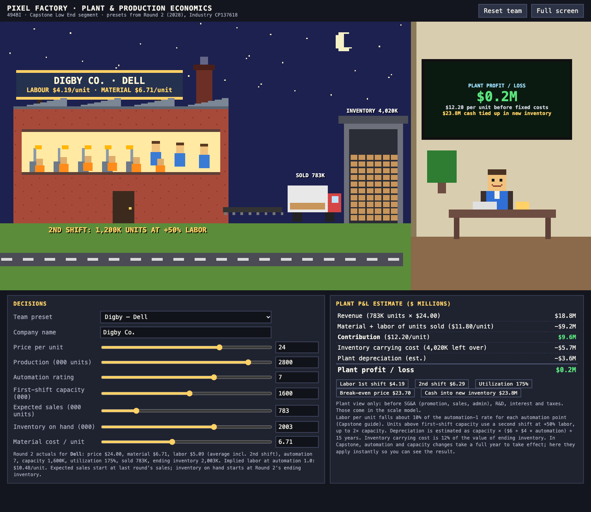
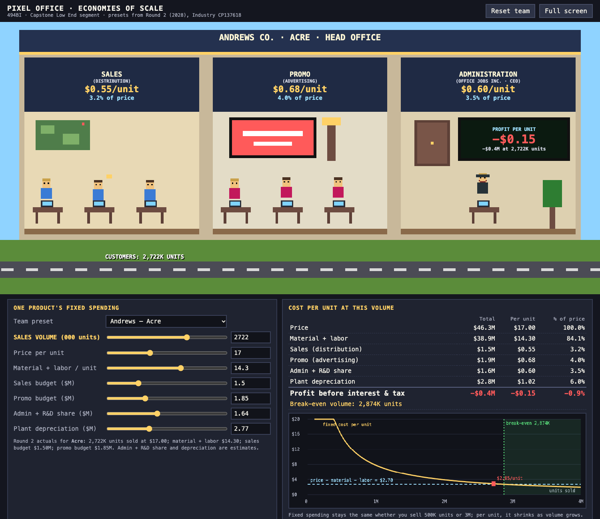
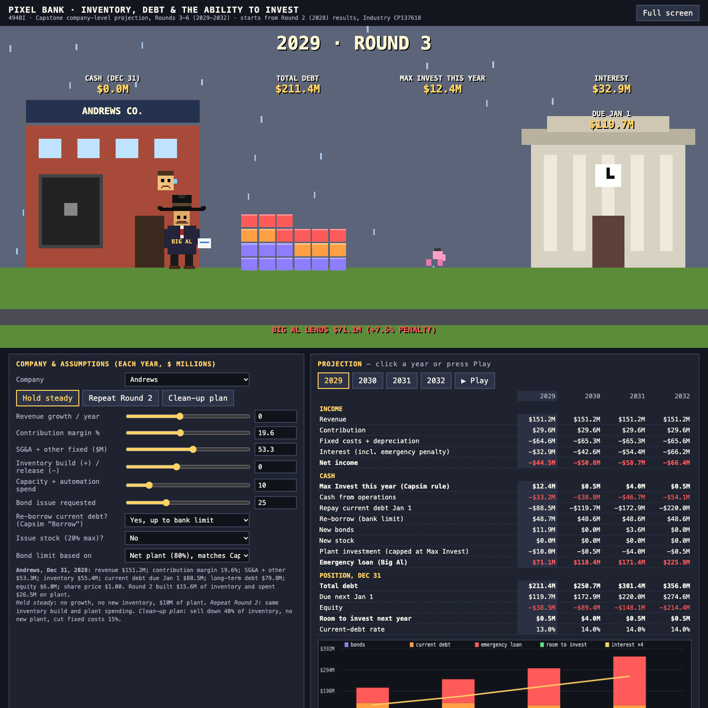

# Capstone Graphic Simulations

*Part of the [Capstone 2.0 Glossary & Guidance](/capstone/).*

Three small pixel-art simulations built for MANAGMNT 494BI, Business Strategy and Policy, at the Isenberg School of Management. Students run companies in the Capsim *Capstone* simulation; these pages show, with toggles and sliders, the economics behind three decisions that sink more teams than any competitor does. Each runs in the browser, works offline once loaded, and sends nothing anywhere.

The presets load Round 2 (2028) results from both class industries (the 1:25 and 2:30 sections); pick one under **Industry data**. Company names are Capstone's standard names (Andrews, Baldwin, Chester and so on), not students. Every number can be changed.

---

## 1. The Second Shift

**Plant and production economics.** A factory makes one sensor; pick any team's product, Low End first. Set price, production, automation and capacity, and watch what happens: past first-shift capacity, night falls, a second shift arrives, and every extra unit costs 50% more in labor. Raise automation and the line workers turn into robot arms as labor cost per unit falls. Unsold units pile up in the warehouse. The controller at the desk smiles when the plant makes money and sweats when it doesn't, and the board behind them shows the cash tied up in new inventory.

*The lesson:* low price is not low cost, and profit is not cash.

[Open The Second Shift](the-second-shift.html)

---

## 2. Spreading the Overhead

**Economies of scale.** A head office with three rooms: Sales (Distribution), Promo (Advertising), and Administration (Office Jobs Inc., with the CEO). Enter one product's sales and promotion budgets, then drag the sales-volume slider. The rooms stay the same size; the cost each one adds per unit, and its share of the price, shrinks as volume grows. A chart marks the break-even volume.

*The lesson:* a low price only works with the volume to carry the fixed costs.

[Open Spreading the Overhead](spreading-the-overhead.html)

---

## 3. Big Al Comes Calling

**Inventory, debt and the ability to invest.** A four-year projection for one company: inventory build or release, plant spending, bond and stock issues, and the current debt that falls due every January 1. When the cash runs out, Big Al, Capstone's emergency lender, arrives at the door with his checkbook and a 7.5% penalty, and his loan becomes next year's debt. Watch the debt tower rise, interest climb, and the room to invest shrink.

*The lesson:* losses and unsold inventory compound through the balance sheet, and the firm that survives early losses may be the one that kept the ability to finance itself.

[Open Big Al Comes Calling](big-al-comes-calling.html)

---

**New rounds.** Each page has a **Load .xlsx** button that reads Capsim Courier workbooks in your browser; nothing is uploaded. Load this round's workbook and every company's and product's actual numbers fill the presets. For *The Second Shift* and *Spreading the Overhead*, also load last round's workbook: it supplies the automation and capacity in effect this round, which the labour and depreciation figures need.

**About the numbers.** The labor, capacity, automation, financing and emergency-loan rules follow the *Capstone* team and administrator guides. Where the guides do not publish an exact formula, the pages use labeled estimates (the interest-rate curve, per-product depreciation). The "Max Invest" limit in *Big Al Comes Calling* was checked against a live Capsim decision screen: 80% of net plant and equipment, less long-term debt, plus 20% of shares at the current share price, plus cash on hand. They are teaching models for direction and scale, not replicas of the simulation's engine; the Capstone decision screens remain the authority.

*Built October 31, 2026, by Matthew D. Langenkamp with Thea.*
