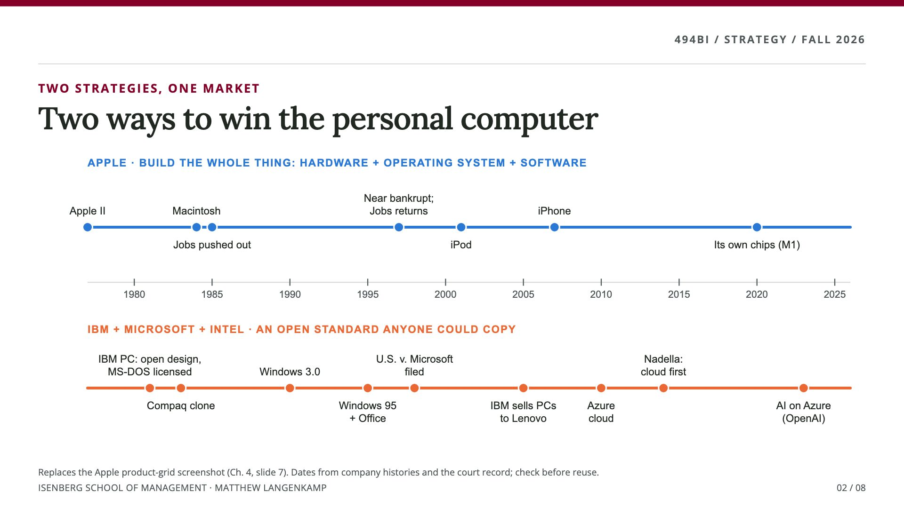
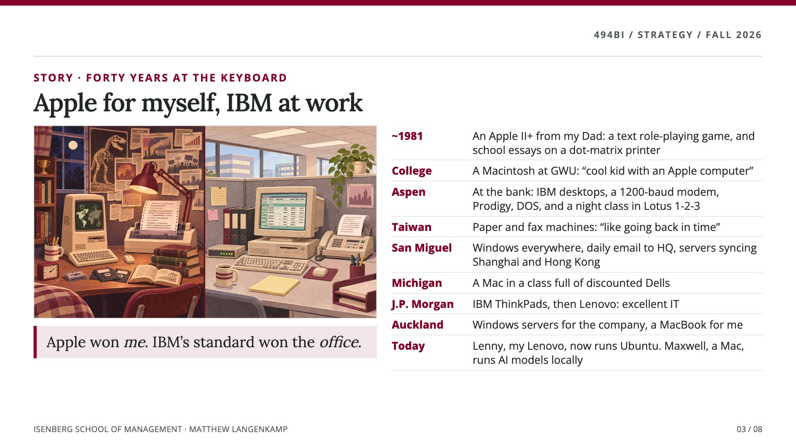
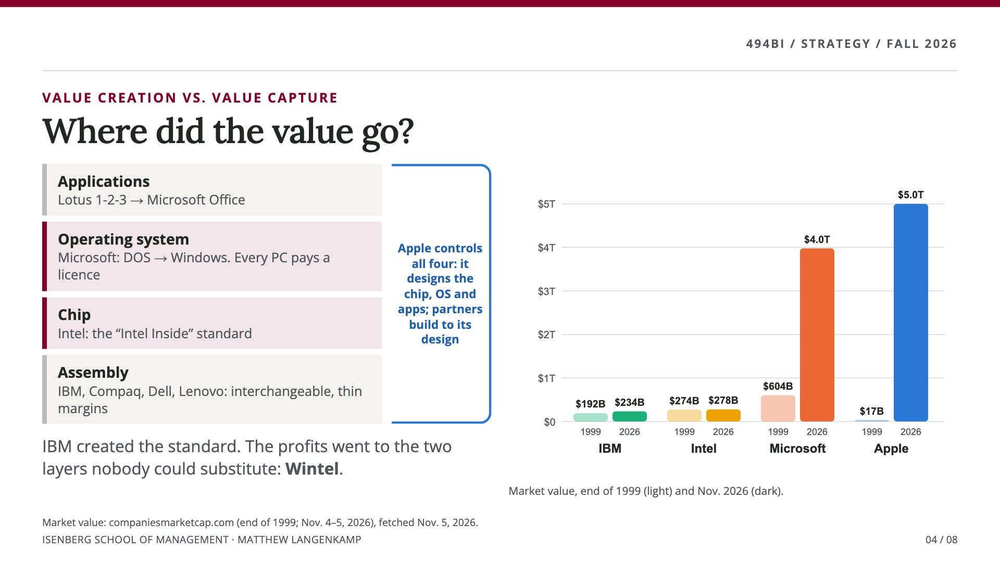
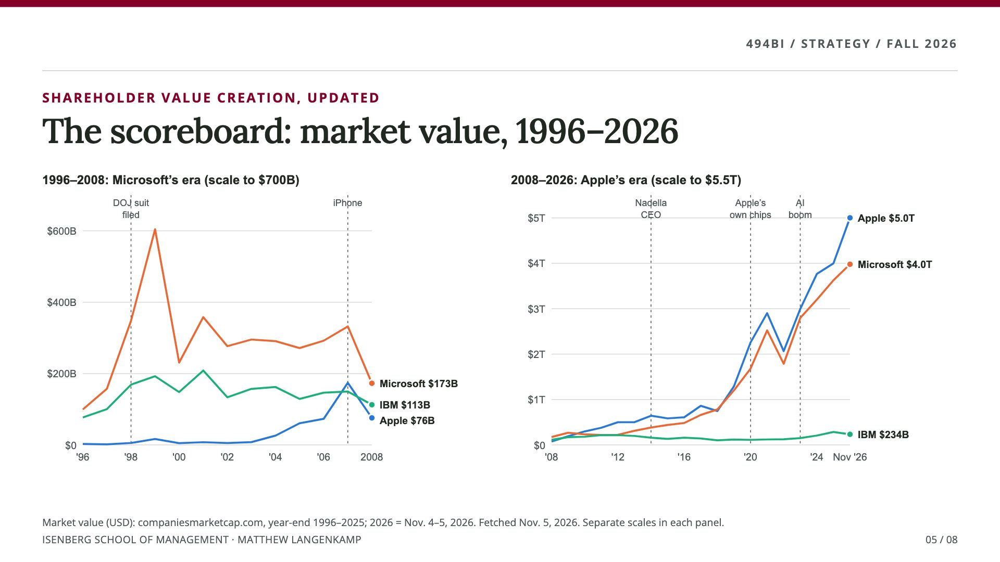
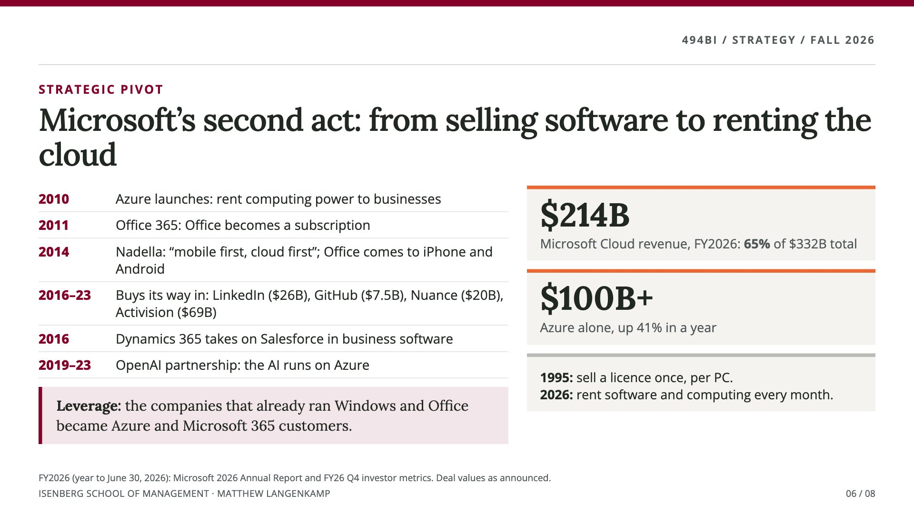
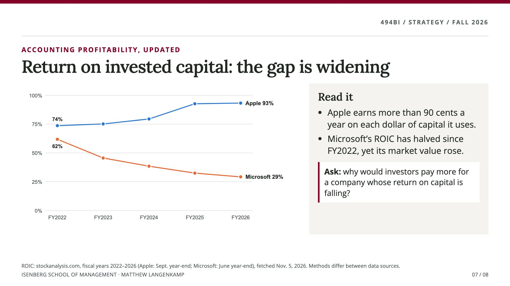
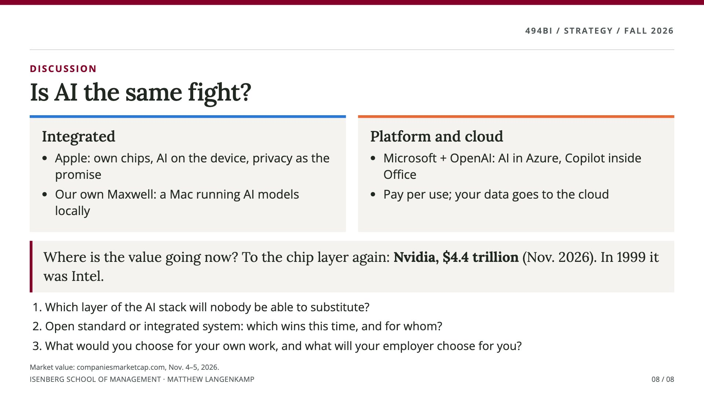

# Two Ways to Win the Personal Computer

*Strategy Atlas · MANAGMNT 494BI · Fall 2026*

Apple, IBM and Microsoft fought over the same machine for forty years and won in very different ways. This page walks through the story in eight slides. Use it to review **core competencies**, **value creation and value capture**, **shareholder value** and **ROIC**, and to think about who will capture the value in AI.

Each slide has a short note on what to notice. Key terms link to the [strategy glossary](/capstone/#strategy-strategy).

---

## 1. Two ways to win

**Notice:** Apple built the whole thing: hardware, operating system and software. IBM moved fast in 1981 by using parts anyone could buy and licensing the operating system from Microsoft. That made the IBM PC the business standard, and it also made it easy to copy. Compaq shipped a compatible machine in 1983.

**Ask yourself:** Which choice looked smarter in 1985? Which looks smarter now?

Terms: [core competencies](/capstone/#strategy-core-competencies) · [imitation](/capstone/#strategy-imitation) · [competitive advantage](/capstone/#strategy-competitive-advantage)

## 2. Apple for myself, IBM at work

**Notice:** I always had Apple computers for myself and IBM-style computers at work. The personal machine was my choice. The work machine was chosen by the company, and companies bought the standard. My Lenovo laptop is a direct descendant of IBM's PC business, which IBM sold to Lenovo in 2005.

**Ask yourself:** Which of your devices did you choose, and which were chosen for you?

## 3. Where did the value go?

**Notice:** IBM created the standard, but the profits went to the two layers nobody could substitute: Microsoft's operating system and Intel's chips ("Wintel"). Assembling PCs became a low-margin business. Apple kept control of every layer and was punished for it in the 1990s. It was worth $17 billion in 1999, while Microsoft was worth $604 billion. Then the phone made the computer personal again.

**Ask yourself:** Using the Five Forces, why did Microsoft and Intel have so much power over the PC makers?

Terms: [value creation](/capstone/#strategy-value-creation) · [value capture](/capstone/#strategy-value-capture) · [bargaining power of suppliers](/capstone/#strategy-bargaining-power-of-suppliers) · [network effects](/capstone/#strategy-network-effects) · [complements](/capstone/#strategy-complements-and-complementors)

## 4. The scoreboard: market value, 1996–2026

**Notice:** Read the axes. The two panels use different scales, because on one scale the 1990s disappear. Microsoft peaked in 1999, then the antitrust case (filed in 1998) and the dot-com crash ended its run. The lead has changed hands several times since. In November 2026 Apple was worth about $5.0 trillion, Microsoft $4.0 trillion and IBM $234 billion.

**Ask yourself:** Was Microsoft's advantage in the 1990s sustainable? Is Apple's today?

Terms: [shareholder value](/capstone/#strategy-shareholder-value) · [sustained competitive advantage](/capstone/#strategy-sustained-competitive-advantage) · [erosion of advantage](/capstone/#strategy-erosion-of-advantage)

## 5. Microsoft's second act

**Notice:** After a flat decade, Microsoft used its relationships with corporate IT departments to change how it makes money. It moved from selling a licence once per PC to renting software and computing every month. In fiscal 2026, Microsoft Cloud brought in $214 billion, 65% of its revenue.

**Ask yourself:** What in Microsoft's 1990s position made this pivot possible? Why couldn't IBM do the same with PCs?

Terms: [business model innovation](/capstone/#strategy-innovation-product-process-and-business-model)

## 6. Return on invested capital

**Notice:** Apple's return on invested capital rose above 90%. Microsoft's halved, yet its market value went up.

**Ask yourself:** Why would investors pay more for a company whose return on capital is falling? Hint: think about what Microsoft is building, and what that costs.

Terms: [ROIC](/capstone/#strategy-return-on-invested-capital-roic) · [firm performance](/capstone/#strategy-firm-performance-three-measures)

## 7. Is AI the same fight?

**Notice:** In 1999 the chip layer (Intel) captured much of the PC's value. In November 2026 Nvidia, the leading AI chip maker, was worth about $4.4 trillion.

**Discuss:**
1. Which layer of the AI stack will nobody be able to substitute?
2. Open standard or integrated system: which wins this time, and for whom?
3. What would you choose for your own work, and what will your employer choose for you?

---

**Sources.** Market values: companiesmarketcap.com, year-end 1996–2025 and November 4–5, 2026. ROIC: stockanalysis.com, fiscal 2022–2026 (methods differ between data providers). Microsoft fiscal 2026: Microsoft 2026 Annual Report. Charts and illustration created for this course. The illustration was AI-generated and shows no real products.

*Published November 5, 2026. More Strategy Atlas topics will follow. Back to [For Students](/for-students/).*
